<div align="center">


# MatSMTP

**An SMTP relay for your network – with rules, a queue and webhooks.**

Applications send to one smarthost; MatSMTP decides how each mail leaves: through which account, with which sender, or to a webhook.
One container, SQLite, no cloud, no third-party services.

</div>

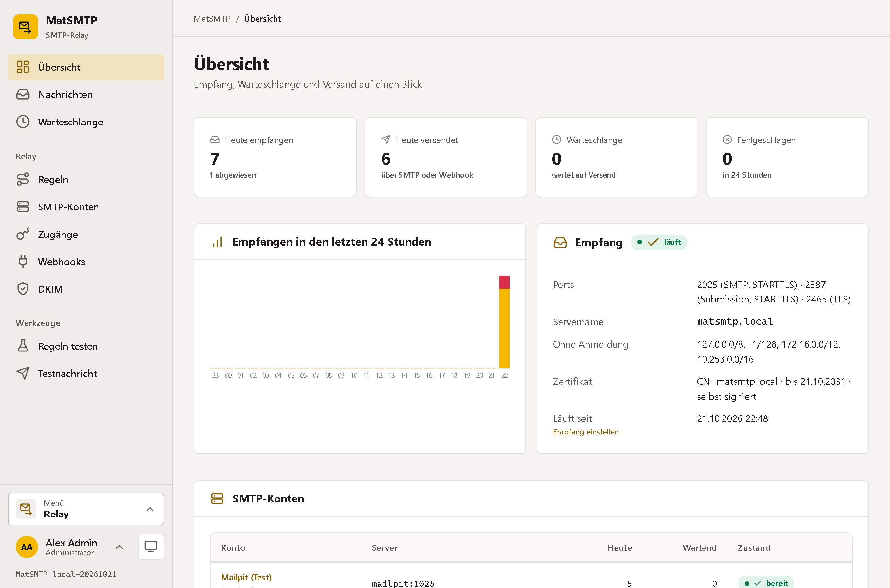

---

## What this is about

Every printer, NAS, shop, monitoring tool and line-of-business app wants to send mail – and every one of them needs its own SMTP account,
its own password, its own idea of TLS. When the provider changes, you touch twenty devices. MatSMTP sits in between: everything in the network
sends to MatSMTP, MatSMTP sends on. It keeps every message in a queue, retries what failed, shows what happened to each mail, and lets you decide
by rules which account, which sender and which webhook a message gets.

## At a glance

**Receiving (smarthost)**
- **SMTP with STARTTLS (25), submission (587) and SMTP over TLS (465)**
- With a **relay user** (SMTP AUTH PLAIN/LOGIN); without signing in only from **trusted networks** (CIDR list, by default only this machine: no open relay)
- A relay user can be **limited to its own senders** (`shop.example.com`, `*@billing.example.com`)
- TLS certificate: **self-signed automatically**, or **uploaded** (PFX or PEM with key)
- Ten wrong passwords from one address lock that address out for 15 minutes

**Rules – policy based routing**
- Conditions on **sender, recipient, client network, relay user and subject** – domains, wildcards, regular expressions
- Actions: send through a **specific account**, **rewrite the sender** (`noreply@example.com`, `{local}@example.com`, display name,
  Reply-To to the old sender), **trigger a webhook**, add a **blind copy**, **webhook only**, **reject** (SMTP 550 with your text) or **drop**
- Evaluated top to bottom like a firewall: every matching rule applies its changes, the first one with a decision ends it
- A **rule tester** shows what would happen to a message before one is sent

**Sending (spooler)**
- Several **SMTP accounts** (Microsoft 365, a mail host, the company server); a **default account** takes what no rule routes elsewhere
- Per account: encryption, sign-in, **forced sender** (the original goes to Reply-To), **limits per minute and per day**, connection check, test mail
- Temporary errors (4xx, network, timeout) are **retried** after configurable waits, permanent ones (5xx) end it
- Every message has its **history**: received, rules, every attempt with the server's answer, webhooks; send again or delete, one or many

**DKIM**
- **Signs outgoing mail** per sender domain (RSA-SHA256, relaxed/relaxed) – as the very last step, after every rewrite, so the signature fits the From that leaves
- Keys are **generated** (RSA 2048 or 1024) or **imported** (PEM from the old mail server), stored encrypted; optionally valid for **subdomains** too
- The page shows the **TXT record** to copy and **looks it up in the DNS** (published, missing, another key, empty key); a new key starts switched off
- Changing a key: a new one with a new selector – the newest active key of a domain signs, the old one can stay in the DNS until it is deleted

**Webhooks**
- HTTP POST with **JSON**: metadata only, with text/HTML/attachment names, or the **complete .eml** (Base64)
- Optionally **signed** (`X-MatSMTP-Signature: t=…,v1=` HMAC-SHA256), extra headers, retries – a mail becomes a ticket

**Users and operations**
- Local sign-in with **TOTP** (authenticator app, recovery codes, enforceable for administrators)
- Roles **Administrator**, **User** (overview, messages, send again, share links, rule tester) and **Anonymous** (a share link)
- **Share links** show someone without an account whether and when a mail was delivered – never its content
- **Scheduled backups** to a **NAS over SMB** or a folder, with **retention** (last N, daily, weekly, monthly), optionally encrypted, restore with a safety copy
- Sessions survive a container restart, **activity log**, light and dark, works on a phone, installable as an app (PWA)

## Screenshots

### Every message and what became of it

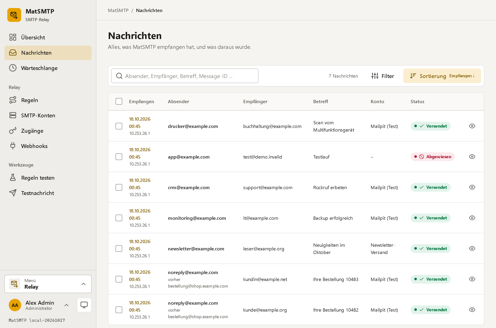

Search, filter (status, account, period, sign-in) and sort above the list; below it, for the selected rows, *Send again* and *Delete*.
A rewritten sender shows the original right underneath.

### One message: envelope, content, history

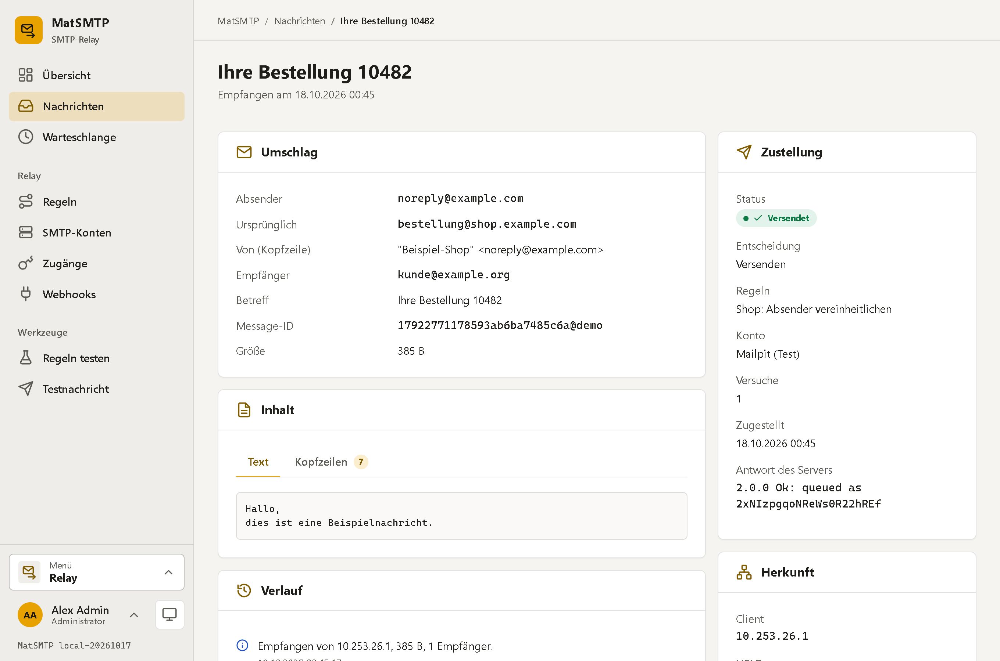

The envelope as it left, the original sender, text and headers, every step in the history, the answer of the receiving server –
and a share link that shows the delivery to someone outside.

### Rules and the rule tester

| Rules in their order | Editing a rule |
|---|---|
| 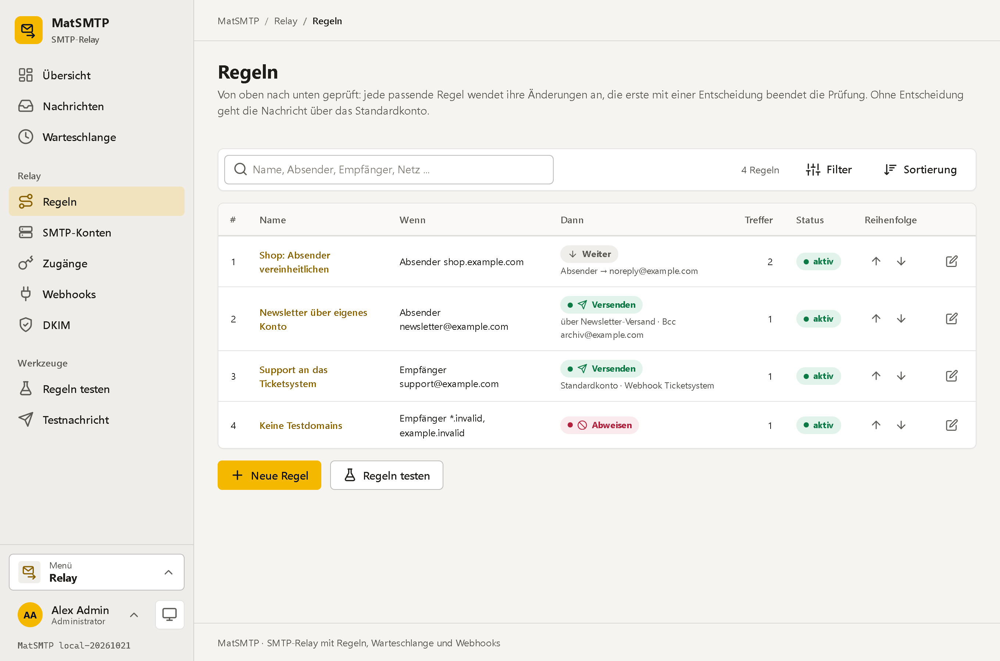 | 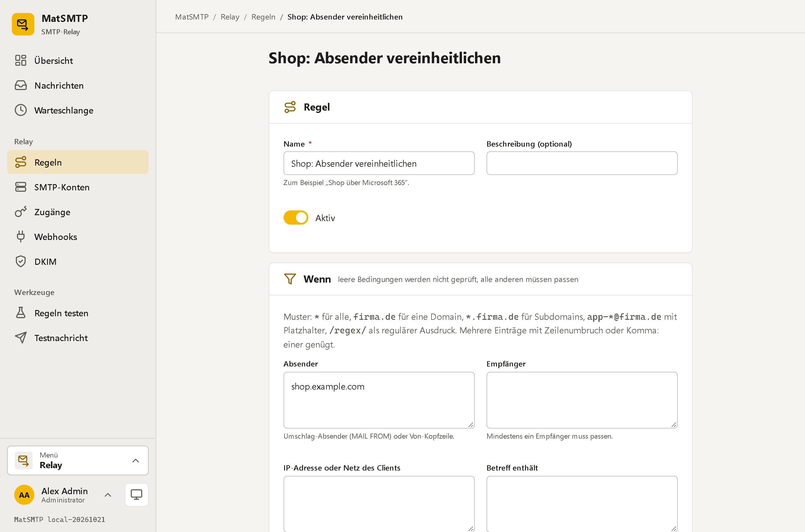 |

The order is the logic: arrows move a rule, the list shows what it matches, what it does and how often it hit.
Fields that do not apply to the chosen action stay hidden.

| Rule tester | Test mail through the whole relay |
|---|---|
| 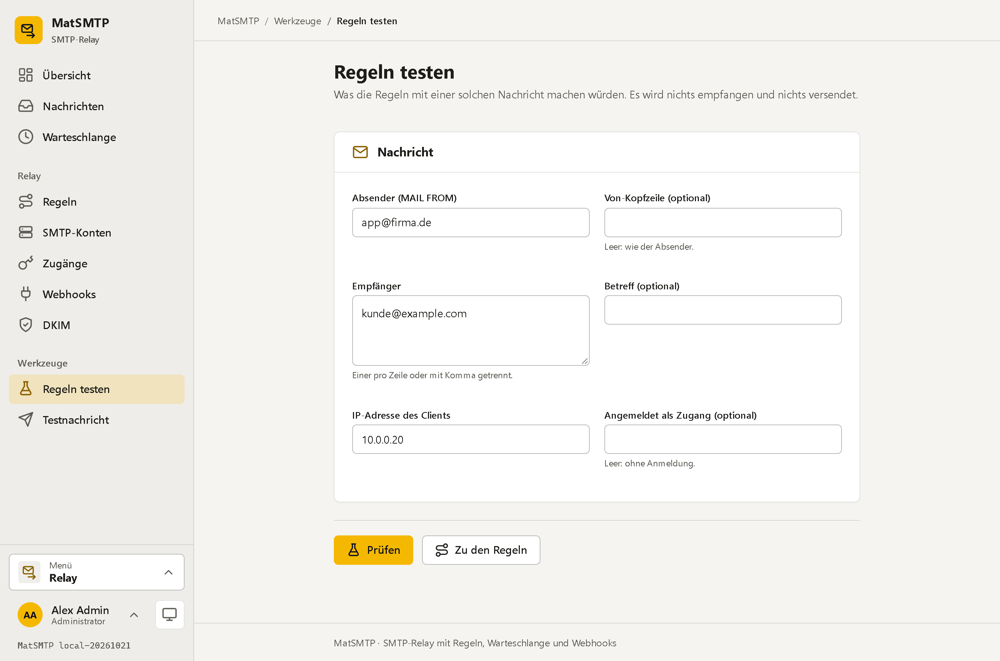 | 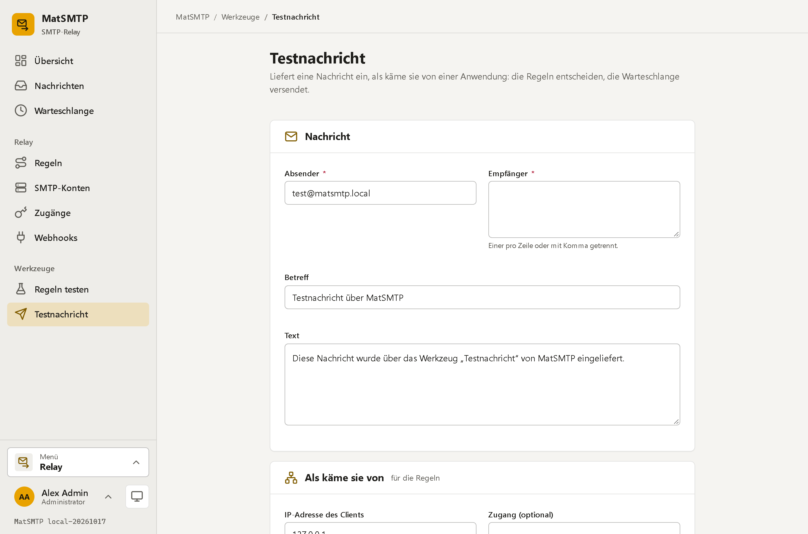 |

### Accounts, relay users, webhooks

| SMTP account | Relay users | Webhook |
|---|---|---|
| 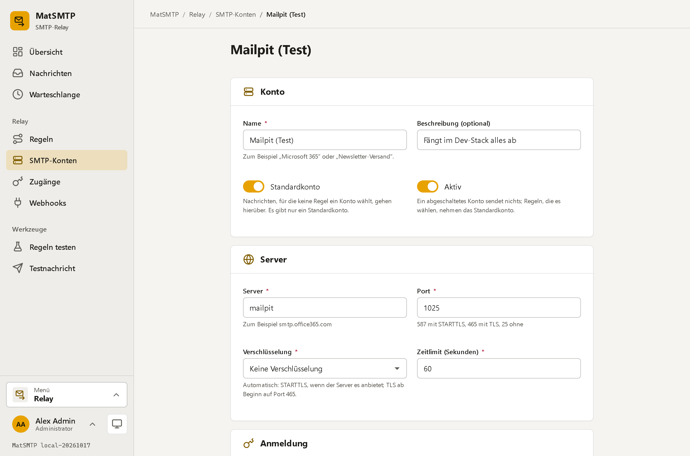 | 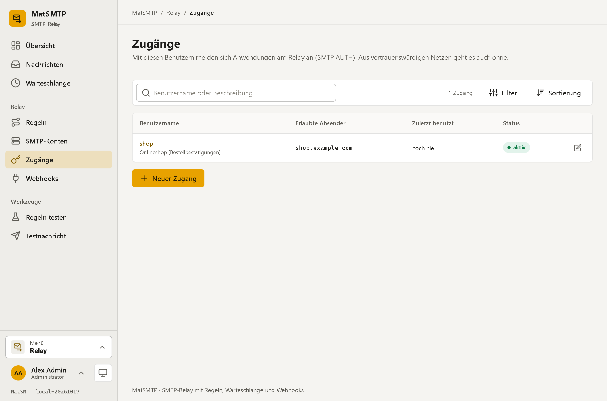 | 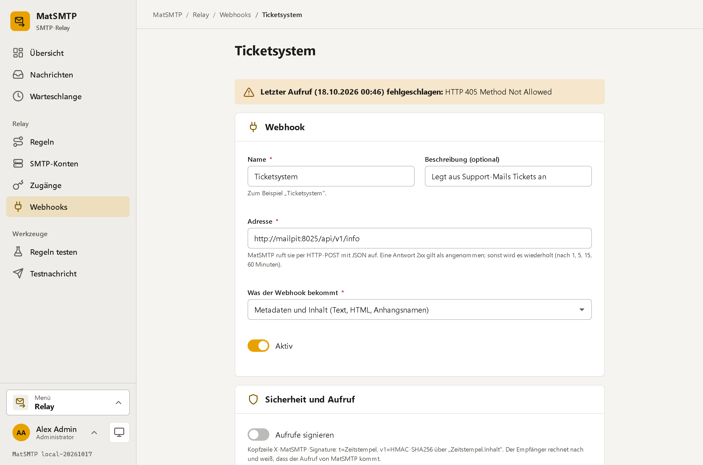 |

### Receiving, delivery and backup

| Receiving (ports, networks, certificate) | Delivery (retries, retention) | Backup target on a NAS |
|---|---|---|
| 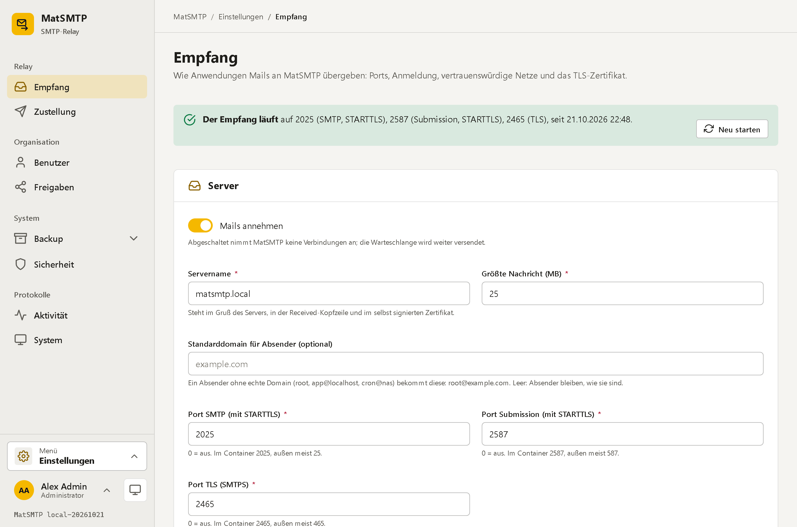 | 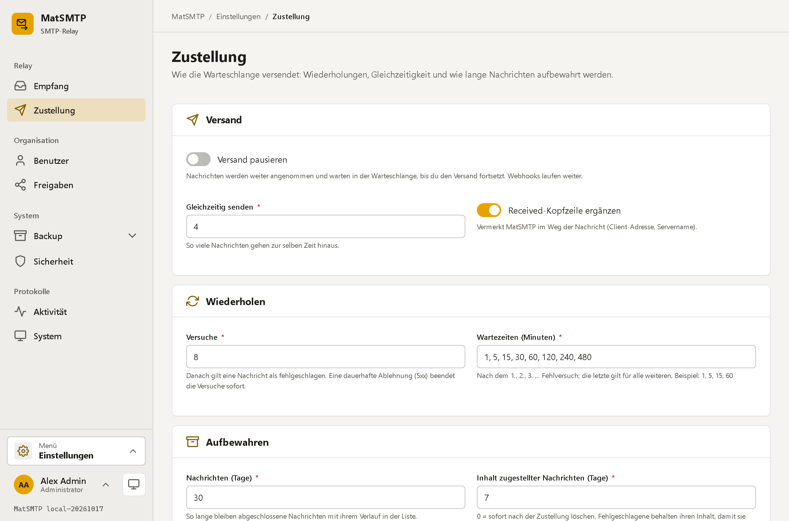 | 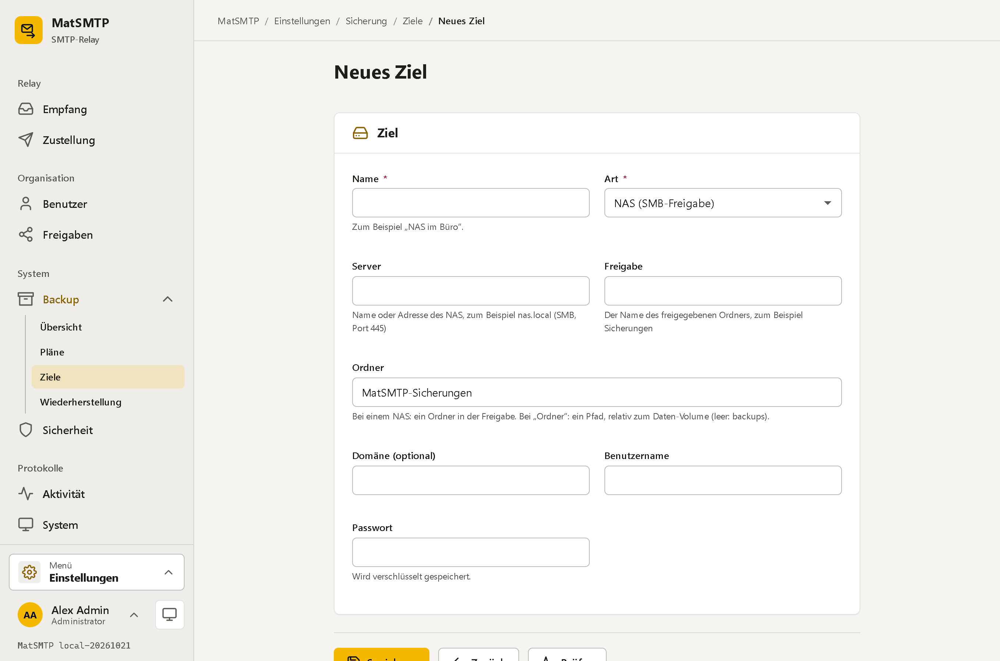 |

### Share link, dark theme and narrow screens

| Share link (anonymous) | Dark | Phone |
|---|---|---|
| 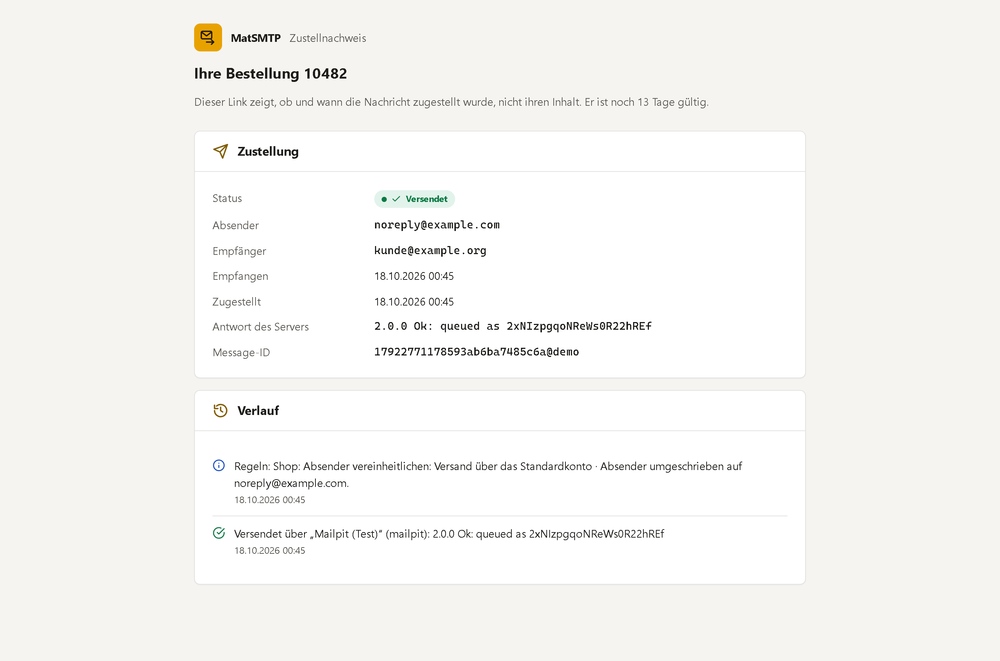 | 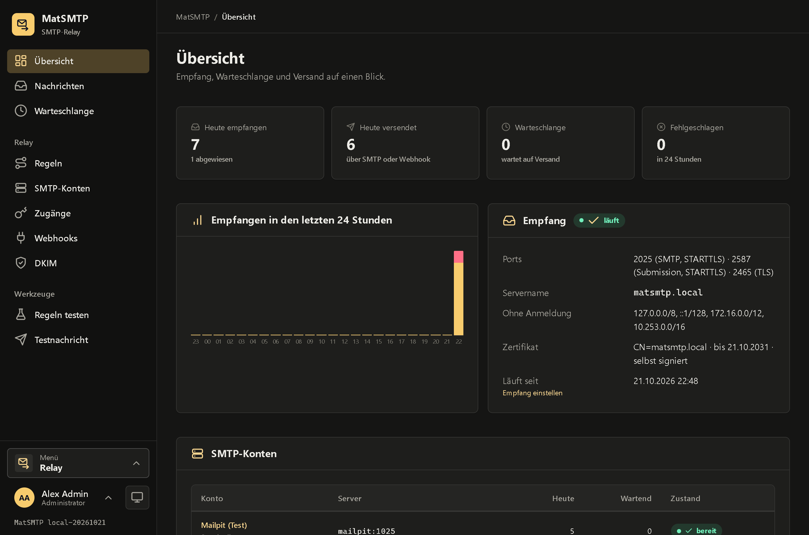 | 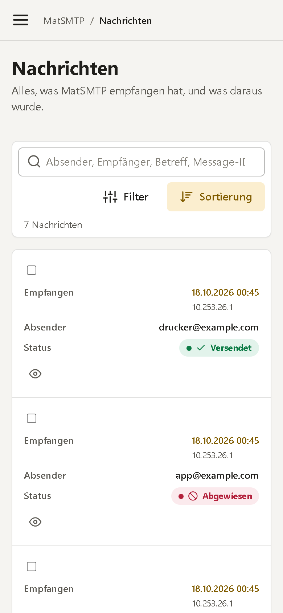 |

## Quick start

Ready-made images are published to the GitHub Container Registry:

| Tag | Built from | Use it for |
|---|---|---|
| `ghcr.io/real-ttx/matsmtp:latest` | `main` | releases |
| `ghcr.io/real-ttx/matsmtp:nightly` | `dev` | the newest features |

### 1. Just run it

Copy this into `docker-compose.yml` and start it – nothing else needed:

```yaml
services:
  matsmtp:
    image: ghcr.io/real-ttx/matsmtp:latest
    container_name: matsmtp
    restart: unless-stopped
    ports:
      - "2525:2525"   # web interface
      - "25:2025"     # SMTP with STARTTLS
      - "587:2587"    # submission with STARTTLS
      - "465:2465"    # SMTP over TLS
    environment:
      TZ: Europe/Berlin
    volumes:
      - matsmtp-data:/data

volumes:
  matsmtp-data:
```

```bash
docker compose up -d
```

Open **http://localhost:2525**: the first visit creates the administrator and then asks for the first SMTP account – the one MatSMTP sends
through. Make it the default account, and the relay works. Health check: `/api/health`. An update is just `docker compose pull && docker compose up -d`.

Without Compose:

```bash
docker run -d --name matsmtp -p 2525:2525 -p 25:2025 -p 587:2587 -p 465:2465 \
  -v matsmtp-data:/data ghcr.io/real-ttx/matsmtp:latest
```

Inside the container SMTP listens on the unprivileged ports 2025, 2587 and 2465; the mapping above makes them 25, 587 and 465 on the host.
If port 25 is taken on the host (a local mail server), map another one: `- "2025:2025"`.

### 2. In production

A real host name, the web interface behind a reverse proxy with TLS, the public address for share links, and backups to a NAS:

```yaml
services:
  matsmtp:
    image: ghcr.io/real-ttx/matsmtp:latest
    container_name: matsmtp
    restart: unless-stopped
    ports:
      - "127.0.0.1:2525:2525"   # web interface only for the reverse proxy on this host
      - "25:2025"
      - "587:2587"
      - "465:2465"
    environment:
      TZ: Europe/Berlin
      MATSMTP__Server__PublicUrl: https://smtp.example.com      # for share links
      MATSMTP__Server__ForceSecureCookie: "true"                # the proxy speaks HTTPS
    volumes:
      - matsmtp-data:/data
      # Backups go to a NAS over SMB from the app (Einstellungen > Backup > Ziele); a mounted folder works as well:
      # - /mnt/nas/matsmtp-backups:/backups

volumes:
  matsmtp-data:
```

Then in the web interface:

1. *Einstellungen → Empfang*: set the **server name** (it appears in the greeting, the Received header and the self-signed certificate) and check the
   **trusted networks** (by default only `127.0.0.0/8` and `::1`) – everything else has to sign in. Upload a certificate for the server name if your applications verify it.
2. *SMTP-Konten*: one **default account**, more if some senders have to leave through another provider.
3. *Zugänge* (relay users): one per application that sends from outside the trusted networks, limited to its senders.
4. *Regeln*: route, rewrite, hand to webhooks, reject. Try them under *Regeln testen*.
5. *Einstellungen → Backup*: a target (NAS share) and a plan with retention. *Einstellungen → Sicherheit*: enforce TOTP for administrators.

> Keep the trusted networks narrow: by default only this machine relays without signing in. Behind Docker's userland proxy a client from the internet
> arrives with the address of the gateway (`172.17.0.1`), so `172.16.0.0/12` (let alone `0.0.0.0/0`) there turns a published port into an open relay.
> Add a LAN range only consciously (a printer that cannot sign in) and only when the port is not reachable from the internet.

### 3. Pointing applications at MatSMTP

| What | Setting |
|---|---|
| Any application / device | SMTP server: the Docker host, port **587** with STARTTLS (or 25, or 465 with TLS) and a relay user |
| Postfix | `relayhost = [smtp.example.com]:587` (plus `smtp_sasl_*` with a relay user from outside the trusted networks) |
| Synology / TrueNAS notifications | SMTP server and port as above, "Secure connection: STARTTLS" |
| Printer / scanner (scan to mail) | Often no TLS: a relay user on port 25 from the LAN, or its address added to the trusted networks |
| A quick test | `curl --url smtp://localhost:25 --user app:<password> --mail-from app@example.com --mail-rcpt you@example.org -T mail.txt` |

### 4. From source

```bash
docker compose -f docker-compose.dev.yml up -d --build    # development stack
./scripts/redeploy.ps1                                    # the same on Windows (rebuild + redeploy)
```

### Settings that matter

| Variable | Default | Meaning |
|---|---|---|
| `MATSMTP_WEB_PORT` | `2525` | Port of the web interface inside the container (`MATSMTP_PORT` is the SMTP port an *application* sends to, set by Mattiverse) |
| `MATSMTP_DATA` | `/data` | Data directory (SQLite, queue, configuration, keys, certificates) |
| `MATSMTP__Server__PublicUrl` | – | The public address, for share links |
| `MATSMTP__Server__TimeZone` | `Europe/Berlin` | Time zone for dates and backup schedules |
| `MATSMTP__Server__ForceSecureCookie` | `false` | Cookie only over HTTPS (behind a TLS proxy) |
| `MATSMTP__Smtp__Port` | `2025` | SMTP port inside the container (`0` = off); set here, the page *Empfang* shows it as fixed |
| `MATSMTP__Smtp__SubmissionPort` | `2587` | Submission port inside the container |
| `MATSMTP__Smtp__TlsPort` | `2465` | SMTPS port inside the container |
| `TZ` | `Europe/Berlin` | Time zone of the container |
| `MATSMTP_ADMIN_PASSWORD` | – | A headless installation: when there is no administrator, `admin` is created with this password (at least 8 characters, not `admin`; no change asked for) and the setup page is skipped. Nothing happens once an administrator exists |
| `MATSMTP_ADMIN_EMAIL` | `admin` | The sign-in name of that administrator |
| `MATSMTP_API_KEY` | – | The key of the management API `/api/v1` (header `X-Api-Key`). Not set: the API answers 503 |
| `MAT_API_KEY` | – | The key of the platform endpoints `/api/*` (header `X-Api-Key`). Not set: `MATSMTP_API_KEY` serves there too |
| `MATIDENTITY_AUTHORITY` | – | The address of MatIdentity (`https://id.example.com`). Set = sign-in through MatIdentity |
| `MATIDENTITY_CLIENT_ID` | `matsmtp` | The client of MatSMTP in MatIdentity |
| `MATIDENTITY_CLIENT_SECRET` | – | Its secret |
| `MATIDENTITY_INTERNAL_URL` | – | Where MatSMTP reaches MatIdentity from inside Docker (`http://matidentity:2300`); the browser keeps using `MATIDENTITY_AUTHORITY` |

Everything else – trusted networks, sign-in rules, size limit, retries, retention, pause – lives in the web interface and in `/data/config/app.json`.

### Who may send, and signing in without TLS

- **Relaying without signing in** only from the *trusted networks* (*Einstellungen → Empfang*), by default **only this machine** (`127.0.0.0/8`, `::1`).
  Behind Docker's userland proxy a client from the internet arrives with the address of the gateway (`172.17.0.1`); with a private range there a published
  port would be an open relay. Every application signs in with its relay user.
- **SMTP AUTH** (it sends the password) is offered:
  - always over TLS: after `STARTTLS` on 25 / 587 (2025 / 2587 in the container), or on 465 (2465);
  - **without TLS only on the internal SMTP port (2025 in the container) and there only to clients from *Anmeldung ohne TLS auf dem SMTP-Port aus diesen
    Netzen*** (default: the loopback and the private ranges `10.0.0.0/8`, `172.16.0.0/12`, `192.168.0.0/16`, `fc00::/7`). That is the port the
    applications in the Docker network use; Mattiverse does not publish it, so a password in clear never crosses the internet, and the applications need not
    trust the self-signed certificate;
  - **on the submission port (587 / 2587) and the TLS port never without TLS**, whatever the address of the client;
  - a client that sends `AUTH` where it is not offered hears `538 5.7.11` before its password is looked at.
- *Anmeldung ohne TLS auf dem SMTP-Port von überall erlauben* lifts the network check on the internal port only (when that port is reachable from trusted
  networks alone); it never opens the submission or the TLS port.

Rules and sender rewriting apply to signed-in senders as to everyone else, and a relay user with *erlaubte Absender* may only use those, in the envelope
(`MAIL FROM`) and in the `From` of the header.

**Default sender domain.** A sender without a real domain (`root`, `app@localhost`, `cron@nas`, `backup@nas.local`) gets the domain of *Standarddomain für
Absender* (*Einstellungen → Empfang*, or `defaultSenderDomain` of the API): `app@localhost` leaves as `app@example.com`, the original stays in
`X-MatSMTP-Original-From` and in the history. A relay user allowed to send as `app@localhost` may do so; the message leaves with the domain. Without a
default domain such a sender stays as it is (and most providers refuse it: then set the domain, or a forced sender on the account).

### The `/data` volume

```
/data
├─ db/matsmtp.db   SQLite: rules, accounts, relay users, webhooks, messages, users, sessions
├─ spool/          the messages as .eml (removed after the retention of the content)
├─ config/         app.json – the settings
├─ keys/           DataProtection keys (sessions and stored passwords survive restarts)
├─ certs/          TLS certificate of the receiver
├─ backups/        local backup targets and safety copies before a restore
└─ tmp/            scratch space of the backup
```

A backup holds the database, the settings, the keys and the certificates – and, if the plan says so, the content of the queued messages.

## Management API (for Mattiverse)

MatSMTP is one of the engines of [Mattiverse](https://github.com/Real-TTX/Mattiverse): Mattiverse gives every app it installs its own SMTP login and
tells it where to send. The API lives under `/api/v1`, speaks JSON (camelCase) and needs the header **`X-Api-Key`** = `MATSMTP_API_KEY`.
Without a configured key every call answers **503**, a wrong or missing key **401**, errors are always `{"error": "..."}`; the cookie of a session counts
for nothing here.

| Method and path | Answer |
|---|---|
| `GET /api/v1/status` | `{"ok": true, "app": "matsmtp", "version": "1.0.42-20261019", "apiVersion": 1, "smtpPort": 2025, "smtpTls": "none", "smtpEnabled": true}` |
| `PUT /api/v1/relay-users/{id}` | upsert of a relay user, see below: `201` (made) or `200` `{"id", "username", "password", "created"}` |
| `GET /api/v1/relay-users` | a plain array `[{"id", "username", "displayName", "allowedSenders", "managedBy", "lastUsedUtc"}]`, never a secret |
| `DELETE /api/v1/relay-users/{id}?managedBy=mattiverse` | `204`; `404` when there is none; `409` when another `managedBy` owns it |
| `GET /api/v1/settings` | `{"setupCompleted": true, "defaultSenderDomain": "example.com"}` |
| `PUT /api/v1/settings` | the same body; either field may be left out; answers like `GET`. `400` for a domain that is none |

**`smtpPort` / `smtpTls`** are what an application **inside the Docker network** uses: the internal SMTP port (`2025`), `none` while AUTH without TLS is
allowed there from the private networks (the default, see above), else `starttls`; without that port the submission port with `starttls` (AUTH never
without TLS there), the TLS port with `tls` only when nothing else listens.

**Relay users.** `{id}` is `[a-z0-9-]{2,64}` and is also the SMTP user name. The body:

```json
{ "displayName": "MatSplit", "allowedSenders": ["matsplit@example.com"], "managedBy": "mattiverse", "renewSecret": false }
```

- `allowedSenders`: at least one entry, each an address (`matsplit@example.com`), a pattern (`*@example.com`, `example.com`) or `*` (any sender).
- The **password** (32 characters) is generated by MatSMTP and returned **only** when the user is made or with `"renewSecret": true`; it is stored as a hash
  (PBKDF2), so it can never be read again. Repeating the same `PUT` changes nothing and returns no password.
- A relay user made with a `managedBy` may only be changed or deleted with the same `managedBy` (`409` otherwise). A relay user made on the page with the
  same name is not taken over (`409`). The pages show *verwaltet von Mattiverse* on such users; their name stays fixed.

**Settings.** `setupCompleted: true` skips the setup page for an installation whose people come through MatIdentity (with an administrator the setup is done
anyway); `defaultSenderDomain` is the default sender domain (`""` switches it off). For a headless install set `MATSMTP_ADMIN_PASSWORD` as well.

## The platform contract and MatIdentity

Besides its own pages MatSMTP speaks the platform contract of the Mat apps ([MatDesign docs/PLATFORM.md](https://github.com/Real-TTX/MatDesign/blob/main/docs/PLATFORM.md),
the shared package MatPlatform, copied to `src/MatSmtp/MatPlatform/`), so Mattiverse (and Matmon) can show, watch and set it up without knowing it:

| Endpoint | Access | What |
|---|---|---|
| `GET /api` | anonymous | the description: id `matsmtp`, the accent, the pages, tiles, settings, actions and the roles `admin` / `user` |
| `GET /api/health` | anonymous | `ok` / `degraded` / `down` with the checks `database`, `smtp` (the receiver listens) and `accounts` (a default account, the last attempt of each); 503 only for `down`. The Docker `HEALTHCHECK` calls it |
| `GET /api/state[/{key}]` | `X-Api-Key` = `MAT_API_KEY` (else `MATSMTP_API_KEY`) or a token of MatIdentity | the tiles: `queued`, `deferred`, `sent24h`, `failed24h`, `received24h`, `lastDelivery`, `accounts`, `accountsHealth`, `webhooksFailing` |
| `GET` / `PUT /api/configure` | the same | the few settings: `hostname`, `defaultSenderDomain`, `trustedNetworks`, the default account (`relayHost`, `relayPort`, `relaySecurity`, `relayUsername`, `relayPassword`, `relayFrom`; made as "Standard" when there is none) and `paused`. The password is never sent back (`{"isSet": true}`) |
| `POST /api/actions/{id}` | the same | `flushDeferred` (send what is deferred now), `retryFailed` (failed messages of the last 24 hours back into the queue), `testAccount` (connect to the default account and sign in, nothing is sent); links to the app, the messages, the queue and the accounts |

**Sign-in through MatIdentity.** With `MATIDENTITY_AUTHORITY` set, a visitor who is not signed in goes straight to MatIdentity (OpenID Connect, code with
PKCE) and comes back signed in; the redirect address is `/signin-oidc`, the signed-out address `/signout-callback-oidc`, the back-channel logout `/signout-backchannel`. The local sign-in (with its
authenticator app) stays at `/Account/Login?local=1`. A person is matched by `sub`; the first sign-in creates the user; the claim `role` (`admin`, `user`)
sets the role. An account of MatSMTP with the person's address is **not** linked by the address: the sign-in page asks once for that account's password
(and its code), then links it; cancel or another account links nothing. Signing out ends the session at MatIdentity too; signing out at MatIdentity (or an
administrator ending the person's sessions there) ends the MatSMTP sessions too: MatIdentity posts a signed logout token to `/signout-backchannel`
(MatPlatform 1.4.0), MatSMTP revokes the sessions that started with its `sid` (or, with `sub` alone, every session of that person), and their next
request lands on the sign-in page. The activity log says so ("Abmeldung über MatIdentity").

## Development

```powershell
./scripts/redeploy.ps1          # rebuild the image and redeploy the dev stack (the project's live-reload / test workflow)
./scripts/redeploy.ps1 -Fresh   # the same with an empty volume (setup again)
dotnet build MatSmtp.slnx
dotnet test MatSmtp.slnx
```

The development stack (`docker-compose.dev.yml`):

| Service | Address | What for |
|---|---|---|
| MatSMTP | http://localhost:2525, SMTP on 2025 / 2587 / 2465 | the app, built from this folder |
| sqlite-web | http://localhost:2526 | the database UI of the stack (what pgAdmin is for PostgreSQL) |
| Mailpit | http://localhost:2527, SMTP on 2528 | a mail server that keeps everything: as an SMTP account use server `mailpit`, port `1025`, no TLS, no sign-in |

The tests need no container: the whole app runs in memory (SQLite in a temporary folder, the receiver on free ports), a real SMTP client sends to it,
a fake upstream server takes what the spooler sends, a small web server receives the webhooks. The SMB backup tests need a Samba server
(`MATSMTP_TEST_SMB=host;share=backups;user=backup;password=backup-secret`; the CI starts one). The browser check (`tests/e2e/flow.js`, Playwright
with the installed Edge) sets up a fresh stack through its forms, sends real mails and takes the screenshots of this page.

## How it is built

- **ASP.NET Core 10** Razor Pages, **EF Core** with **SQLite** (WAL)
- Receiving: **SmtpServer**; reading and rewriting messages: **MimeKit**; sending: **MailKit**; backups to a NAS: **SMBLibrary**
- The rule engine, patterns, networks and sender rewriting are a library without web types (`MatSmtp.Core`), covered by unit tests
- Content first, then the row: a message is on disk before it is acknowledged; a crash puts messages that were being sent back into the queue
- DKIM signatures with MimeKit's **DkimSigner**, the DNS lookup with **DnsClient**
- Secrets (account passwords, webhook secrets, DKIM private keys, the NAS password) encrypted via **DataProtection**; relay user and user passwords hashed (PBKDF2-SHA512)
- The look is **MatUi** from MatDesign (copied into `wwwroot/ui`, never loaded from elsewhere) – plain CSS and JavaScript, no build step,
  a strict content security policy

The interface is German (menu names in this README are given as they appear there); code, comments and the notes for development are English.

## Branches & versioning

| Branch | Purpose | Version |
|---|---|---|
| `main` | Release | `<major>.<minor>.<build>-<yyyyMMdd>` |
| `dev` | Development | `nightly-<build>-<yyyyMMdd>` |
| local | – | `local-<yyyyMMdd>` |

`Major`/`Minor` live in [`Directory.Build.props`](Directory.Build.props), the build number comes from the GitHub action (`github.run_number`).
Images are published to the GitHub Container Registry.
